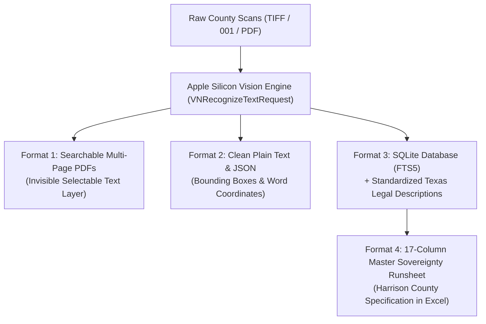

# Texas County Clerk Apple Silicon OCR & Master Sovereignty Runsheet Pipeline

An enterprise-grade, hardware-accelerated OCR and Master Sovereignty Runsheet generation pipeline designed specifically for Apple Silicon (M1/M2/M3/M4 Pro/Max) and Texas County Clerk deed archives.

---

## Architecture Overview



---

## The 4 Standard Output Formats

Every county processed through this pipeline yields the complete 4-format data suite:

1. **`Searchable_PDFs/`**: Original high-resolution visual scans with an embedded invisible text layer (`kCGTextInvisible`). Openable and searchable via `Cmd + F` in Apple Preview, Adobe Acrobat, or any PDF viewer.
2. **`Text_JSON/`**: Clean UTF-8 `.txt` per document and `.json` containing exact page dimensions, line bounding boxes (`x`, `y`, `w`, `h`), and confidence scores.
3. **`Database/[county]_records.sqlite`**: SQLite master database with an **FTS5 full-text search virtual table** (`instruments_fts`) for sub-millisecond keyword queries, and automated Texas legal description extraction:
   * **Abstract**: `A-XXX`
   * **Survey**: `[Name] Sur`
   * **Block**: `Blk [Code]`
   * **Lot**: `Lot [Code]`
   * **Section**: `Sec [Num]`
   * **Acreage**: `[Num] Ac`
4. **`Runsheets/[County] Master Sovereignty Runsheet.xlsx`**: Formatted according to the strict **Harrison County Runsheet Standard**:
   * Header Row 6: `Aptos Narrow 10.5pt Bold` on `#1B365D` navy fill with white text, centered, height 28pt.
   * Data Rows 7+: `Calibri 10pt Regular`, height 18pt, thin gray borders.
   * Freeze Panes: Row 6 (`ySplit="6"`, `topLeftCell="A7"`).
   * Enriched: Column N (`PROPERTY DESCRIPTION`) and Column O (`ABSTRACTOR'S NOTES`: `OCR Legal: ...`).

---

## Apple Vision Intelligence & Crash-Proof Hardware Architecture

### 1. Exact Apple Vision Intelligence Configuration
Tuned for maximum accuracy on historical 1885 cursive handwriting, faint clerk stamps, and deed marginalia:
* **Deep Neural Architecture**: `VNRequestTextRecognitionLevelAccurate` (Deep transformer neural network)
* **Contextual Linguistic Language Model**: `usesLanguageCorrection = YES` (Resolves ambiguous handwriting letterforms)
* **Pinned Language**: `recognitionLanguages = ["en-US"]`
* **Full-Resolution Scan Processing**: `minimumTextHeight = 0.0` (Zero downscaling; captures fine pen flourishes and stamps)
* **Model Revision**: `revision = VNRecognizeTextRequestRevision3` (Apple's modern Transformer handwriting model)

### 2. Dynamic Hardware RAM Probing & 22 GB / 2.0 GB Split
Designed for sustained, multi-day runs over millions of scans without memory exhaustion or kernel panics:
* **Hardware Probing**: Automatically detects total physical RAM and CPU cores on startup.
* **The 22 GB / 2.0 GB Split**: On a 24 GB Mac (e.g. Mac Mini M4 Pro), reserves only 2.0 GB for macOS kernel and `watchdogd`, unlocking **22.0 GB for active computing**. On other machines (16 GB, 32 GB, 64 GB), automatically calculates the proportional safe split.
* **Worker Process Recycling (`maxtasksperchild = 50`)**: Child processes terminate and respawn every 50 tasks, forcing the macOS kernel to unmap Metal, CoreGraphics, and PyObjC heap allocations, permanently eliminating memory leaks.
* **Kernel Memory Pressure Gate**: Continuously monitors `sysctl kern.memorystatus_vm_pressure_level`. Pauses and flushes garbage collection if memory pressure rises to WARN ($\ge 2$).
* **Throughput**: ~24–28 pages/second (~1,500 pages/min, ~90,000 pages/hour) with 10 parallel workers on M4 Pro.

---

## Quick Start Guide

### 1. Requirements
* macOS Sonoma or Sequoia on Apple Silicon (M1/M2/M3/M4 Pro/Max).
* Python 3.11+ with PyObjC, Quartz, Vision, psutil, and openpyxl:
  ```bash
  python3 -m venv ~/county_env
  source ~/county_env/bin/activate
  pip install pyobjc psutil openpyxl pillow
  ```

### 2. Run OCR on Any Texas County
```bash
python3 universal_county_ocr.py \
  --county "Brazos" \
  --input-dir "/Volumes/WD_BLACK_8tb/County Clerks/Brazos County Data/BRAZOSCC" \
  --output-dir "/Volumes/WD_BLACK_8tb/County Clerks/Brazos County Data" \
  --outputs all \
  --workers 10 \
  --ram-floor 2.0
```

### 3. Build or Enrich Master Sovereignty Runsheet
```bash
python3 universal_runsheet_builder.py \
  --county "Brazos" \
  --db-path "/Volumes/WD_BLACK_8tb/County Clerks/Brazos County Data/brazos_ocr_results.db" \
  --runsheet-dir "/Volumes/WD_BLACK_8tb/Runsheets"
```

---

## Antigravity Skill Integration

This repository includes a native Antigravity skill in `skills/texas-county-ocr/SKILL.md`.

To enable this skill in your environment:
```bash
# Global installation (available to any project on this Mac):
mkdir -p ~/.gemini/config/skills/texas-county-ocr
cp skills/texas-county-ocr/SKILL.md ~/.gemini/config/skills/texas-county-ocr/

# Workspace installation:
mkdir -p .agents/skills/texas-county-ocr
cp skills/texas-county-ocr/SKILL.md .agents/skills/texas-county-ocr/
```
Once installed, simply ask Antigravity:
> *"Run the standardized OCR pipeline on Reeves County"* or *"Build the Master Sovereignty Runsheet for Brazos County"*

---

## County Specific Guides
* [Brazos County Processing Guide](counties/brazos/BRAZOS_COUNTY_MAC_MINI_OCR_GUIDE.md)
* [Reeves County Processing Guide](counties/reeves/REEVES_COUNTY_MAC_MINI_OCR_GUIDE.md)

---

## Pushing to Your GitHub

To push this repository to your GitHub account:

```bash
cd /Users/ryan/WORK/texas-county-ocr
git remote add origin https://github.com/<your-username>/texas-county-ocr.git
git branch -M main
git push -u origin main
```
